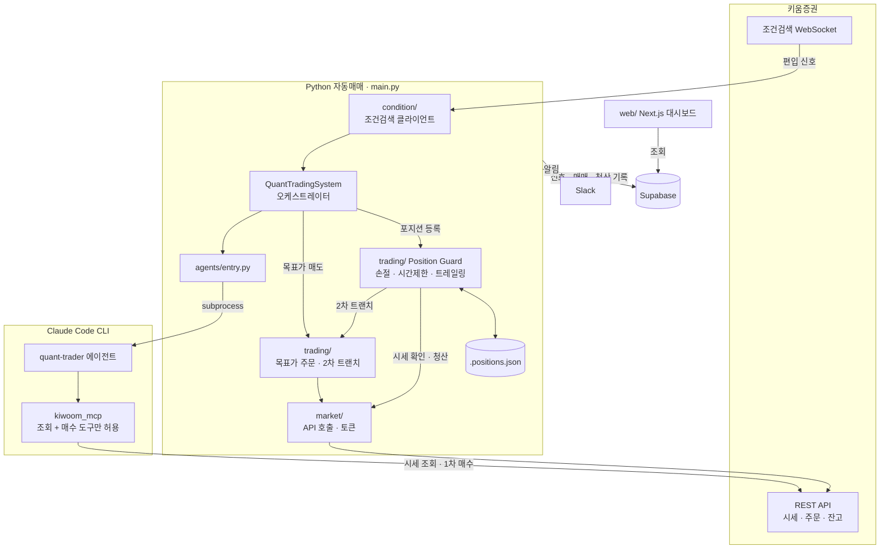

# claude-workshop

키움증권 REST API로 조건검색 신호를 실시간 수신하고, **진입(매수)은 Claude Code CLI 에이전트가 판단**하며 **청산(매도)은 코드 기반 Position Guard가 관리**하는 주식 자동매매 시스템입니다. 매매 기록은 Supabase에 저장되고, Next.js 대시보드로 성과를 확인합니다.

> ⚠️ 실계좌 매매 전에는 반드시 `KIWOOM_USE_MOCK=true`로 모의투자 환경에서 충분히 검증하세요.

## 아키텍처



**AI는 진입 판단에만 쓰입니다.** 에이전트는 키움 MCP를 거쳐 1차 매수까지만 할 수 있습니다. 매도 주문과 청산 판단은 모두 Python 코드 쪽(Position Guard)에서 처리합니다.

## 동작 흐름

```
조건검색 편입 (WebSocket)
   → AI 진입 판단 (Claude Code CLI · quant-trader 에이전트)
   → 1차 트랜치 매수 + 목표가 지정가 매도 주문
   → Position Guard (5초 주기): 손절 / 보유시간 제한 / 트레일링 스탑 / 2차 트랜치 추가매수
   → 15:20 잔여 포지션 전량 강제 청산
```

- **AI는 진입에만 사용합니다.** `quant-trader` 에이전트는 키움 MCP 도구로 시세·호가·잔고를 조회한 뒤 매수 여부를 결정하고, 매수 시 1차 주문까지 직접 냅니다. 매도·정정·취소 도구는 화이트리스트에서 제외되어 있습니다.
- **청산은 코드가 담당합니다.** `trading/position_guard.py`가 손절/익절/시간제한/트레일링 스탑을 판단하고 안전 청산(지정가 취소 → 잔고 확인 → 시장가 매도)을 실행합니다.
- **분할 매수/매도**: 1차 트랜치(기본 60%) 매수 후 눌림 또는 모멘텀 조건에서 2차 트랜치를 추가 매수하고, 빠른 목표가 도달 시 일부 물량을 먼저 익절합니다.
- 종료(Ctrl+C) 시 보유 포지션은 청산하지 않고 `.positions.json`에 남겨 두며, 다음 실행 때 복구해 계속 감시합니다.

## 요구 사항

- Python 3.11+ 및 [uv](https://docs.astral.sh/uv/)
- [Claude Code CLI](https://docs.claude.com/en/docs/claude-code) (`claude`가 PATH에 있거나 `CLAUDE_BIN`으로 경로 지정)
- 키움증권 REST API 앱키/시크릿키 (모의투자 권장)
- 키움 MCP 서버 — `.mcp.json`에 `kiwoom_mcp`로 등록되어 진입 에이전트가 사용합니다 (별도 프로젝트)
- Supabase 프로젝트 (DB 기록·대시보드 사용 시)
- Slack Bot 토큰 (알림 사용 시)
- Node.js (대시보드 사용 시)

## 설치 및 설정

```bash
uv sync
cp .env.example .env   # 값 채우기
```

주요 환경변수 (전체 목록은 [.env.example](.env.example) 참고):

| 변수 | 설명 |
| --- | --- |
| `KIWOOM_APP_KEY`, `KIWOOM_SECRET_KEY`, `KIWOOM_ACCOUNT_NO` | 키움 API 인증 정보 (앞의 두 개는 필수) |
| `KIWOOM_USE_MOCK` | `true`면 모의투자 서버(`mockapi.kiwoom.com`) 사용 |
| `ENTRY_MODEL`, `ENTRY_AGENT_TIMEOUT_SEC` | 진입 판단 모델과 타임아웃 |
| `TRADE_AMOUNT`, `MAX_POSITIONS`, `MAX_DAILY_LOSS` | 1회 매수금액, 최대 보유 종목 수, 일일 손실 한도 |
| `TARGET_PCT`, `STOP_LOSS_PCT`, `MAX_HOLD_MINUTES` | 기본 전략 (아래 `STRATEGY_MAP` 미등록 조건식용) |
| `TRAILING_ACTIVATE_PCT`, `TRAILING_DROP_PCT` | 트레일링 스탑 발동/하락 기준 |
| `SPLIT_TRADE_ENABLED`, `TRANCHE*`, `QUICK_TARGET_*` | 분할 매수/매도 설정 |
| `CONDITION_IDS` | 구독할 조건식 이름 또는 seq (쉼표 구분, 비우면 계좌의 조건식 전체) |
| `DB_ENABLED`, `SUPABASE_URL`, `SUPABASE_KEY` | Supabase 기록 |
| `SLACK_BOT_TOKEN`, `SLACK_CHANNEL_*` | Slack 알림 |

### 조건식별 전략

조건식마다 목표가·손절가·최대 보유시간을 다르게 쓰려면 [config.py](config.py)의 `STRATEGY_MAP`에 항목을 추가합니다. 등록되지 않은 조건식은 `.env`의 기본값을 사용합니다.

```python
STRATEGY_MAP: dict[str, StrategyParams] = {
    "장중외국인기관동반매수스윙": StrategyParams(
        target_pct=2.5, stop_pct=-1.5, max_hold_min=320, skip_after_hour=14, style="default",
    ),
}
```

### 데이터베이스

[migrations/](migrations/)의 SQL을 번호 순서대로 Supabase에 적용합니다. 주요 테이블은 `hts_conditions`, `signals`, `trades`, `sell_orders`, `daily_summaries`, `kiwoom_token`입니다.

## 실행

```bash
# 자동매매 시스템 시작
uv run python main.py

# 조건검색 WebSocket 연결 점검 (10초간 신호 출력, 매매 없음)
uv run python test_condition.py

# 자연어로 조건검색식 JSON 생성 (condition-searcher 에이전트)
uv run python -m agents.condition_generator "외국인과 기관이 동반 순매수하는 종목"
```

생성된 조건식은 사람이 검토한 뒤 `conditions/`에 보관하고 `STRATEGY_MAP` 등록 여부를 직접 결정합니다.

## 모의투자 테스트

실계좌로 넘어가기 전에 아래 순서대로 모의투자 환경에서 검증합니다.

### 1. 모의투자 모드 설정

키움 Open API 사이트에서 **모의투자용** 앱키·시크릿키·계좌번호를 발급받아 `.env`에 넣습니다.

```bash
KIWOOM_USE_MOCK=true    # mockapi.kiwoom.com (REST·WebSocket 모두)
TRADE_AMOUNT=500000     # 테스트용으로 작게
MAX_POSITIONS=1
```

> ⚠️ 진입 에이전트는 매수 주문을 **키움 MCP 서버**로 냅니다. MCP 서버는 `.env`가 아니라 `.mcp.json`의 `kiwoom_mcp.env`를 읽습니다. 그래서 이쪽도 `KIWOOM_USE_MOCK=true`와 모의투자 키로 맞춰 두어야 합니다. 두 설정이 다르면 신호는 모의 서버에서 받고 주문은 실계좌로 나갈 수 있습니다.

키움 접근 토큰은 Supabase `kiwoom_token` 테이블에 모드별(`mock`/`real`)로 따로 저장됩니다. 그래서 모의 토큰과 실계좌 토큰이 섞이지 않습니다.

DB나 Slack 없이 매매 흐름만 보고 싶다면 `DB_ENABLED=false`로 두고 `SLACK_BOT_TOKEN`을 비워 두면 됩니다. 이때 DB 기록은 건너뛰고 Slack 알림은 콘솔 로그로 대신 출력됩니다.

### 2. 청산 로직 오프라인 확인 (장 시간 무관)

`check_exit()`는 API·DB·시계에 의존하지 않는 순수 함수라서, 장이 닫혀 있어도 손절·시간제한·트레일링 판단을 바로 확인할 수 있습니다.

```bash
uv run python - <<'EOF'
import datetime as dt
from zoneinfo import ZoneInfo
import config
from trading.models import Position
from trading.position_guard import check_exit

t0 = dt.datetime(2026, 10, 2, 10, 0, tzinfo=ZoneInfo("Asia/Seoul"))
name = "장중외국인기관동반매수스윙"
pos = Position(
    stock_code="005930", stock_name="테스트", entry_price=10_000, quantity=10,
    entry_time=t0, condition_name=name, strategy=config.get_condition_strategy(name),
    exchange="KRX", order_no="TEST", high_water_mark=10_000,
)
print(check_exit(pos, 9_840, t0 + dt.timedelta(minutes=1)))     # -1.6% → 손절
print(check_exit(pos, 10_050, t0 + dt.timedelta(minutes=1)))    # +0.5% → None (보유 유지)
print(check_exit(pos, 10_050, t0 + dt.timedelta(minutes=321)))  # 320분 초과 → 시간초과
EOF
```

### 3. 조건검색 수신 확인

```bash
uv run python test_condition.py
```

시작 줄에 `(모의투자)`가 찍히는지 확인합니다. 그 뒤 접속 → 인증 → 구독 로그가 정상적으로 나오는지 봅니다. 장 시간(09:00~15:30)이 아니면 신호가 한 건도 오지 않는 것이 정상입니다.

### 4. 전체 시스템 실행 (장중)

```bash
uv run python main.py
```

다음 순서로 확인합니다.

| 단계 | 확인할 것 |
| --- | --- |
| 시작 | 로그에 `QuantTradingSystem 시작 (모의투자)`, Slack 시작 알림의 모드가 `모의투자` |
| 신호 | 조건 편입 시 Slack 신호 알림, `signals` 테이블에 행 추가 |
| 진입 판단 | AI 판단 결과(매수/패스)가 `signals`에 기록. 매수 시 1차 트랜치 체결 + 목표가 지정가 매도 주문 |
| 보유 | 5초 주기 Position Guard 감시, 조건 충족 시 2차 트랜치 추가 매수 |
| 청산 | `trades.exit_reason`에 `손절`·`익절`·`트레일링`·`시간초과`·`목표가`(지정가 매도 전량 체결) 중 하나가 기록 |
| 장 마감 | 15:20에 남은 포지션 전량 시장가 청산 (`exit_reason = 장마감`) |

진입 판단은 장 시작 후 `SKIP_BEFORE_MIN`분(기본 09:05) 이후부터, 조건식의 `skip_after_hour`(기본 14시) 이전까지만 합니다. 이 시간대 밖에서는 신호가 와도 매수하지 않습니다.

Ctrl+C로 종료해도 보유 포지션은 청산되지 않습니다. 포지션은 `.positions.json`에 남고, 다시 실행하면 이어서 감시합니다. 재시작 후 복구 로그(`복구 포지션 N개`)가 나오는지도 확인해 보세요.

### 5. 결과 확인

[대시보드](#대시보드-web)의 `/trades`, `/signals`, `/daily-pnl` 페이지에서 매매 내역, AI 판단, 일별 손익을 확인합니다. 며칠간 승률과 손익이 기대 수준인지 본 뒤에 실계좌 전환을 검토합니다.

### 실계좌 전환 체크리스트

- [ ] `.env`와 `.mcp.json` 양쪽 모두 `KIWOOM_USE_MOCK=false`, 실계좌 키·계좌번호로 교체
- [ ] `TRADE_AMOUNT`, `MAX_POSITIONS`를 감당 가능한 수준으로 설정
- [ ] 시작 로그와 Slack 알림의 모드가 `실계좌`로 바뀌었는지 확인

## 대시보드 (web/)

Next.js 16 + lightweight-charts 기반 대시보드로, Supabase Postgres를 직접 조회합니다.

```bash
cd web
npm install
cp .env.local.example .env.local   # DATABASE_URL (Supabase Session Pooler) 입력
npm run dev                        # http://localhost:3000
```

| 페이지 | 내용 |
| --- | --- |
| `/dashboard` | 오늘 신호·보유 포지션·손익 요약, 최근 30일 손익, 최근 매매 |
| `/trades` | 매매 내역 및 상세(진입일 1분봉 차트) |
| `/signals` | 조건검색 신호와 AI 판단 결과 |
| `/conditions` | 조건식별 성과(승률·손익) |
| `/daily-pnl` | 최근 90일 일별 손익, 누적 손익 차트 |

## 프로젝트 구조

```
main.py          QuantTradingSystem 오케스트레이터 (엔트리포인트)
config.py        환경변수 로딩, STRATEGY_MAP
db.py            Supabase 기록 (TradingDB)
agents/          Claude Code CLI 호출 — 진입 판단(entry.py), 조건식 생성(condition_generator.py)
market/          키움 REST API 호출, 토큰 관리
trading/         주문 실행, 포지션 저장, Position Guard, 분할 매수(tranche)
condition/       조건검색 WebSocket 클라이언트
notifier/        Slack 알림
conditions/      생성된 조건검색식 JSON
migrations/      Supabase 스키마
web/             Next.js 대시보드
.claude/agents/  quant-trader, condition-searcher 에이전트 정의
```
